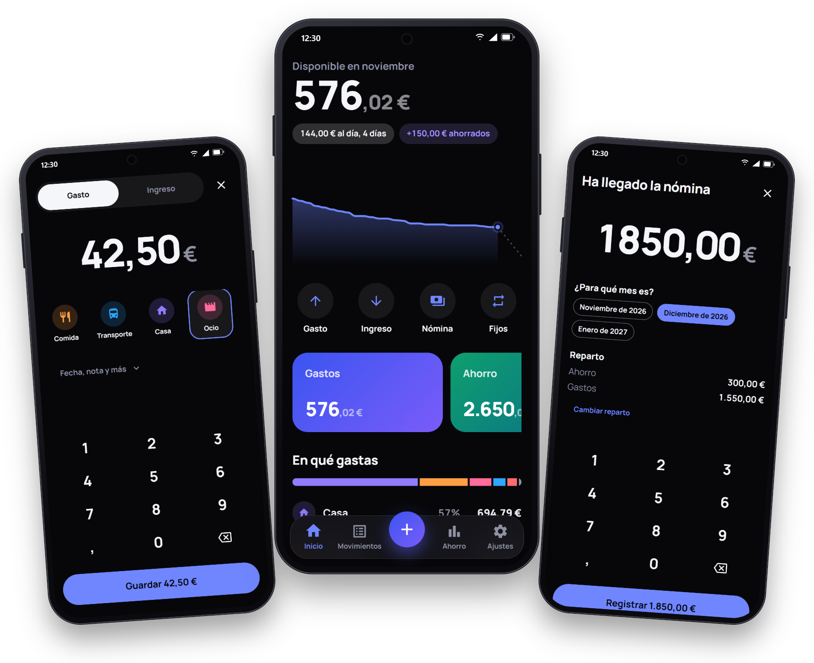
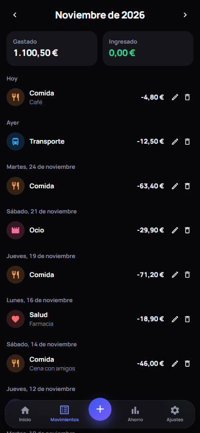

<div align="center">


# Holgura

**Control de nómina, gastos y ahorro para Android, sin conexión.**

Holgura calcula cuánto dinero se puede gastar realmente cada mes.<br>
Funciona sin conexión, sin cuentas y sin servidores. La aplicación no dispone de permiso de internet.

[](https://github.com/Glinbor10/holgura/releases/latest)


[](LICENSE.md)

[**Descargar la aplicación (APK)**](https://github.com/Glinbor10/holgura/releases/latest)

<br>



</div>

## Descripción

Holgura responde a una pregunta concreta: cuánto dinero queda disponible este mes una vez descontados los gastos y atendidos el ahorro y los gastos fijos. Para ello registra la nómina, los gastos y los ingresos ocasionales, y presenta el importe disponible junto con el ritmo de gasto diario que permite llegar a fin de mes.

Todos los datos se almacenan exclusivamente en el dispositivo.

## Características

| Función | Descripción |
|---|---|
| Dinero disponible | Importe disponible del mes y gasto diario recomendado, con una gráfica interactiva de su evolución. |
| Registro de la nómina | Un único paso al cobrar. Se indica el mes al que corresponde y se aparta automáticamente la parte destinada al ahorro. |
| Gastos e ingresos | Entrada de importes mediante teclado numérico propio y categorías identificadas con icono. |
| Gastos fijos | Generación automática de pagos recurrentes (alquiler, suscripciones, etc.) el día indicado, con posibilidad de pausarlos. |
| Cierre de mes | Al finalizar el mes se decide el destino del sobrante, o la forma de cubrir un déficit. |
| Ahorro | Histórico mensual y total acumulado. |
| Copia de seguridad | Exportación e importación de los datos en un fichero que el usuario conserva donde prefiera. |
| Apariencia | Modo claro y modo oscuro, según la configuración del dispositivo. |

### Registro de un gasto

<p align="center">
  
</p>

<details>
<summary>Más capturas</summary>
<br>
<p align="center">
  
  
  
</p>
<p align="center">
  
  
  
</p>
</details>

## Funcionamiento

El cálculo se basa en dos ideas: a qué mes corresponde cada ingreso y qué parte del dinero se reserva para el ahorro.

- **Mes que financia.** Cada nómina indica el mes que cubre. Una nómina cobrada a final de mes financia, por defecto, el mes siguiente.
- **Dinero disponible.** Es la parte de los ingresos destinada a gastos en el mes, más el remanente arrastrado del mes anterior, menos los gastos ya registrados.
- **Ahorro.** El importe ahorrado es la suma de:
  - la cantidad apartada para ahorro en cada nómina;
  - los sobrantes que el usuario decide traspasar al ahorro al cerrar un mes;
  - menos los importes que se utilizan del ahorro para cubrir un déficit.

  El ahorro no se calcula de forma automática como diferencia entre lo ingresado y lo gastado. Si al cerrar el mes el sobrante se arrastra al mes siguiente en lugar de traspasarse, no computa como ahorro.

## Privacidad y seguridad

La aplicación está diseñada para que la información financiera permanezca bajo control exclusivo del usuario. Las siguientes afirmaciones son verificables:

- **Sin permiso de internet.** Sin dicho permiso, Android no permite a la aplicación conectarse a ninguna red. Puede comprobarse en los ajustes del dispositivo, en *Aplicaciones > Holgura > Permisos*.
- **Verificación en cada versión.** Al compilar el APK se leen sus permisos y se publican en las notas de la versión. Si apareciera algún permiso de red, la versión no se publica.
- **Sin copia automática de Android.** La copia en la nube de Android está desactivada para esta aplicación, de modo que ningún dato se transfiere a la cuenta de Google.
- **Sin cuentas, servidores ni analíticas.** El código fuente es público.
- **Almacenamiento privado.** Los datos residen en la memoria privada de la aplicación, a la que no pueden acceder otras aplicaciones.

Las copias de seguridad son responsabilidad del usuario, que las exporta cuando lo considera oportuno. Si se desinstala la aplicación o se cambia de dispositivo, dicha copia es el único medio de recuperar los datos.

## Instalación en Android

1. Desde el dispositivo, abrir la [última versión](https://github.com/Glinbor10/holgura/releases/latest) y descargar el fichero `.apk` de la sección *Assets*.
2. Abrir el fichero e instalarlo. Android solicitará autorización para instalar aplicaciones de orígenes desconocidos.

> [!IMPORTANT]
> Antes de actualizar, se recomienda exportar una copia de seguridad desde Configuración y guardarla fuera de la aplicación. Android no conserva ninguna copia automática de Holgura.

> [!NOTE]
> **Aviso de Google Play Protect.** Android puede mostrar el mensaje «Aplicación bloqueada para proteger tu dispositivo» o «Play Protect no conoce ninguna otra aplicación de este desarrollador». Es habitual en las aplicaciones que no se distribuyen a través de Google Play. Para continuar, debe pulsarse la opción **Instalar de todas formas** (la opción «Entendido» cancela la instalación).

### Verificación de la firma

La huella SHA-256 del certificado con el que se firman todas las versiones es:

```
93aa3a7aa18eccbde21e21d02ebc6f7a86f1184c52ac9986fafc859da6b7f6d0
```

Puede comprobarse con `apksigner verify --print-certs holgura-vX.Y.Z.apk`. La huella figura también en las notas de cada versión.

## Estado del proyecto

Versión 0.1, en fase de pruebas. Pueden existir errores. Los fallos detectados pueden comunicarse mediante las [incidencias](https://github.com/Glinbor10/holgura/issues/new/choose), sin adjuntar datos personales ni copias de seguridad reales.

## Hoja de ruta

- [ ] Importación de movimientos desde el fichero CSV del banco
- [ ] Objetivos de ahorro con nombre y meta
- [ ] Versión web instalable para iPhone
- [ ] Presupuestos por categoría con avisos

## Licencia

Holgura se distribuye bajo la licencia [PolyForm Noncommercial 1.0.0](LICENSE.md). Se permite usar, estudiar y modificar el software con fines no comerciales: uso personal, afición, educación y organizaciones sin ánimo de lucro. El uso comercial requiere autorización previa del titular.

Se trata de una licencia de código disponible. No es una licencia de código abierto en el sentido estricto de la Open Source Initiative, que no admite restricciones al uso comercial.

Required Notice: Copyright (c) 2026 Guillermo Linares Borrego

<sub>Código y guía de desarrollo: [`docs/DESARROLLO.md`](docs/DESARROLLO.md) · Seguridad: [`SECURITY.md`](SECURITY.md)</sub>
