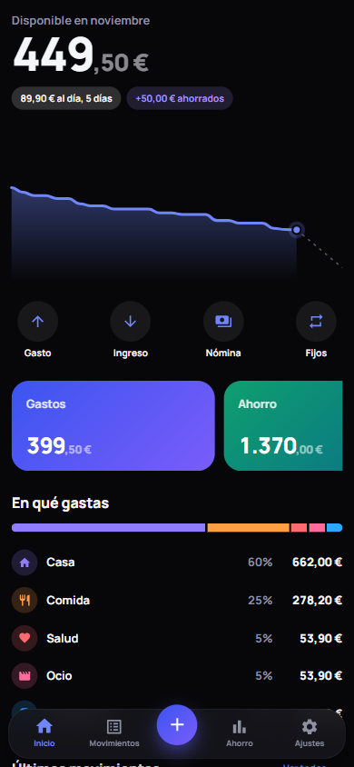

<div align="center">


# Holgura

**Cuánto puedes gastar de verdad.**

App Android para controlar tu nómina, tus gastos y tu ahorro.<br>
Sin conexión, sin cuentas y sin servidores: tus datos no salen de tu móvil.

[](https://github.com/Glinbor10/holgura/actions/workflows/ci.yml)
[](https://github.com/Glinbor10/holgura/releases)
[](LICENSE)


[**Descargar APK**](https://github.com/Glinbor10/holgura/releases) · [Cómo funciona](#cómo-piensa-el-dinero) · [Desarrollo](#desarrollo)

<br>




</div>

## Qué hace

| | |
|---|---|
| 💶 **Te dice cuánto te queda** | El dinero disponible del mes y el ritmo diario, con una gráfica que recorres con el dedo. |
| 🧾 **Reparte tu nómina** | Cuando cobras, la divides entre destinos: por ejemplo 300 € a ahorro y el resto a gastos. |
| ⚡ **Apunta un gasto en segundos** | Teclado numérico propio y categorías con icono. |
| 🔁 **Gastos fijos automáticos** | Alquiler, gimnasio o suscripciones se crean solos el día que elijas, y se pueden pausar. |
| ✅ **Cierre de mes** | Si te sobra, decides si pasa a ahorro o se arrastra. Si te falta, decides si lo cubres con ahorro. |
| 🐷 **Ahorro mes a mes** | Histórico y total acumulado. |
| 💾 **Copia de seguridad** | Un fichero que guardas donde quieras y restauras en otro móvil. |
| 🌗 **Claro y oscuro** | Sigue el modo de tu móvil. |

<details>
<summary>Más capturas</summary>
<br>
<p align="center">
  
  
  
  
</p>
</details>

## Cómo piensa el dinero

Holgura separa dos cosas: **dónde está** tu dinero y **para qué mes es**.

- **Destinos:** son bolsillos con saldo (por ejemplo *Gastos* y *Ahorro*). Su saldo no se reinicia cada mes.
- **Mes que financia:** cada ingreso dice qué mes cubre. Si cobras el día 28, esa nómina financia por defecto el mes siguiente, así el dinero de noviembre cuenta para diciembre y no descuadra el mes en curso.
- **Lo que puedes gastar** es lo que financian tus ingresos ese mes, más lo que arrastras del anterior, menos lo ya gastado.

## Privacidad

- Los datos se guardan solo en el móvil, en una base de datos local.
- La app no pide ningún permiso de Android y no usa internet.
- No hay cuentas, ni servidores, ni analíticas.

Las copias de seguridad son cosa tuya: las exportas cuando quieres y las guardas donde quieras.

## Instalar en Android

1. Descarga el `.apk` de la [última versión](https://github.com/Glinbor10/holgura/releases) (sección **Assets**) desde tu móvil.
2. Ábrelo e instálalo. Android te pedirá permitir la instalación desde orígenes desconocidos.

> [!IMPORTANT]
> **Antes de actualizar, exporta una copia de seguridad** desde Ajustes. Si algún día hay que desinstalar la app, esa copia es lo único que recupera tus datos.

> [!NOTE]
> Para que una actualización se instale encima de la anterior sin perder datos, el APK tiene que estar firmado siempre con la misma clave ([`docs/SIGNING.md`](docs/SIGNING.md)). Las versiones marcadas como *pre-release* llevan un APK de debug, válido para probar pero no para uso diario.

## Estado

Versión **0.1, en pruebas**.

- ✅ La lógica del dinero (reparto de nómina, cierre de mes, gastos fijos, ahorro) está cubierta por tests automáticos.
- ✅ La interfaz está revisada en un navegador a tamaño de móvil, en claro y oscuro.
- ⏳ Sin verificar todavía en un móvil real: el guardado en SQLite, exportar e importar copias, y la instalación del APK firmado.

## Qué viene después

- [ ] Importar movimientos desde el CSV del banco
- [ ] Objetivos de ahorro con nombre y meta
- [ ] Versión web instalable para iPhone
- [ ] Presupuestos por categoría con avisos

## Desarrollo

Pila: React, TypeScript, Vite, MUI y Capacitor para empaquetar la app Android. La base de datos es SQLite.

```bash
cd app
npm ci
npm run dev      # en el navegador (guarda los datos en localStorage)
npx tsc -b       # tipos
npm test         # tests de la lógica y de la capa de datos
npm run build
```

Las reglas del dinero viven en `app/src/domain` como funciones puras, sin acceso a la base de datos ni a la interfaz, y por eso se prueban fácilmente.

| Carpeta | Contenido |
|---|---|
| [`app/`](app/README.md) | Código de la app |
| [`openspec/`](openspec/changes/v0-1-mvp/proposal.md) | Especificación del producto, diseño técnico y tareas |
| [`docs/`](docs/SIGNING.md) | Cómo firmar el APK y capturas de pantalla |
| `.github/workflows/` | CI de las pull requests y publicación de versiones con su APK |

### Publicar una versión

```bash
git tag v0.2.0 && git push origin v0.2.0
```

O desde **Actions > Release > Run workflow**. El workflow compila el APK y crea la release con él adjunto. Sin clave de firma, la release sale como pre-release con un APK de debug.

## Contribuir

Este repositorio es público, pero `main` está protegida: los cambios entran solo por pull request y necesitan la aprobación del propietario. Antes de abrir una PR, comprueba que `npx tsc -b`, `npm test` y `npm run build` pasan. Para dudas o errores usa las [issues](https://github.com/Glinbor10/holgura/issues/new/choose). Las vulnerabilidades se reportan en privado ([`SECURITY.md`](SECURITY.md)).

## Licencia

[PolyForm Noncommercial 1.0.0](LICENSE). Puedes usar, estudiar y modificar Holgura para fines **no comerciales**: uso personal, aficiones, educación y organizaciones sin ánimo de lucro. El uso comercial necesita permiso previo del titular.

Es una licencia de código disponible, no una licencia open-source en el sentido estricto de la OSI, que no permite restringir el uso comercial.

Required Notice: Copyright (c) 2026 Guillermo Linares Borrego
