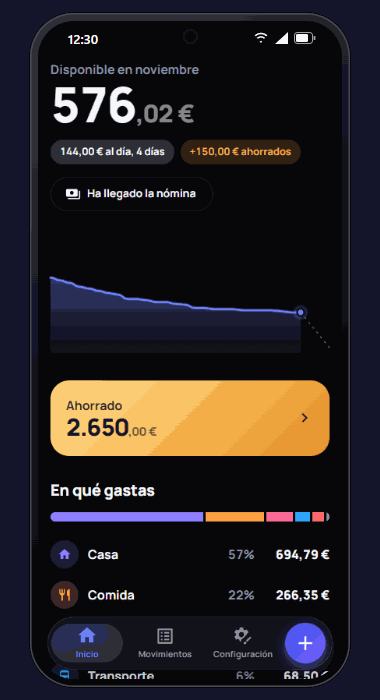
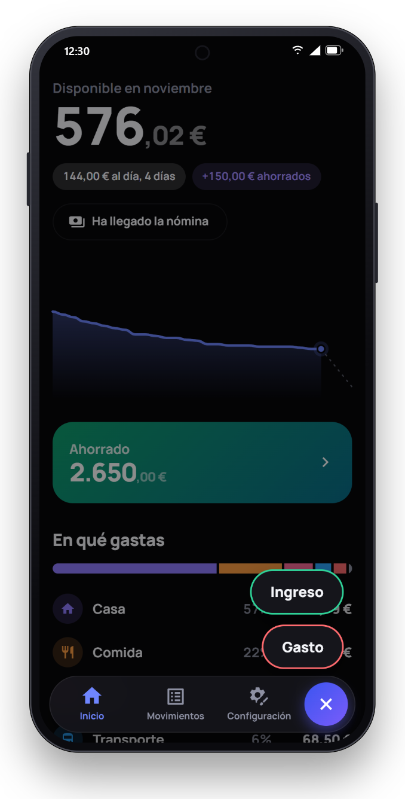
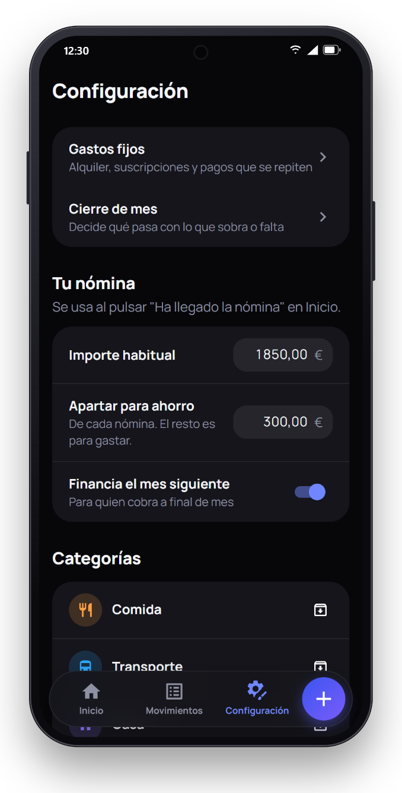
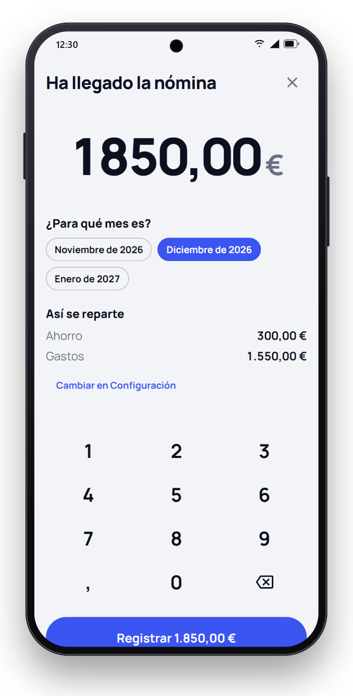

# Holgura

**Cuánto puedes gastar de verdad.**

App Android para controlar tu nómina, tus gastos y tu ahorro. 
Sin conexión, sin cuentas y sin servidores: tus datos no salen de tu móvil. 
La app **no tiene permiso de internet**: no puede enviar nada a ningún sitio.

[**⬇ Descargar la app (APK)**](https://github.com/Glinbor10/holgura/releases/latest)

 

## Qué hace

| | |
|---|---|
| 💶 **Te dice cuánto te queda** | El dinero disponible del mes y el ritmo diario, con una gráfica que recorres con el dedo. |
| 🧾 **Registra tu nómina** | Cuando cobras, un toque. Eliges para qué mes es y se aparta sola tu parte de ahorro, por ejemplo 300 €; el resto es para gastar. |
| ⚡ **Apunta un gasto en segundos** | Teclado numérico propio y categorías con icono. |
| 🔁 **Gastos fijos automáticos** | Alquiler, gimnasio o suscripciones se crean solos el día que elijas, y se pueden pausar. |
| ✅ **Cierre de mes** | Si te sobra, decides si pasa a ahorro o se arrastra. Si te falta, decides si lo cubres con ahorro. |
| 🐷 **Ahorro mes a mes** | Histórico y total acumulado. |
| 💾 **Copia de seguridad** | Un fichero que guardas donde quieras y restauras en otro móvil. |
| 🌗 **Claro y oscuro** | Sigue el modo de tu móvil. |

### Así se apunta un gasto

  

Más capturas

 

  
  
  
  

  
  
  

## Cómo piensa el dinero

Holgura separa dos cosas: **dónde está** tu dinero y **para qué mes es**.

- **Destinos:** son bolsillos con saldo (por ejemplo *Gastos* y *Ahorro*). Su saldo no se reinicia cada mes.
- **Mes que financia:** cada nómina dice qué mes cubre. Si cobras a final de mes, esa nómina financia el mes siguiente: lo que cobras hoy es lo que gastarás en diciembre.
- **Lo que puedes gastar** es lo que financian tus ingresos ese mes, más lo que arrastras del anterior, menos lo ya gastado.

## Privacidad

Holgura está pensada para que tus finanzas sean solo tuyas. Y no tienes que fiarte de mi palabra:

- **No tiene permiso de internet.** Sin ese permiso, Android no deja a la app conectarse a ninguna red, aunque quisiera. Compruébalo en los ajustes de tu móvil: *Apps > Holgura > Permisos*.
- **Cada versión lo demuestra.** Al compilar el APK se leen sus permisos y se publican en las notas de la release; si apareciera algún permiso de red, la versión no se publica.
- **Sin copia automática de Android.** La copia en la nube de Android está desactivada para esta app: ningún dato pasa a tu cuenta de Google.
- **Sin cuentas, ni servidores, ni analíticas.** El código es público.
- **Tus datos están en la memoria privada de la app**, que las demás apps no pueden leer.

Las copias de seguridad son cosa tuya: las exportas cuando quieres y las guardas donde quieras. Si desinstalas la app o cambias de móvil, esa copia es lo que recupera tus datos.

## Instalar en Android

1. Desde tu móvil, abre la [última versión](https://github.com/Glinbor10/holgura/releases/latest) y descarga el fichero `.apk` de la sección **Assets**.
2. Ábrelo e instálalo. Android te pedirá permitir la instalación desde orígenes desconocidos.

> [!NOTE]
> **Aviso de Google Play Protect.** Android puede decir "Aplicación bloqueada para proteger tu dispositivo" o "Play Protect no conoce ninguna otra aplicación de este desarrollador". Es normal en cualquier app que no viene de la Play Store. Pulsa el texto pequeño **Instalar de todas formas** (no "Entendido", que cancela la instalación).
>
> Si quieres comprobar que el APK es el original, la huella SHA-256 de su firma es:
> `93aa3a7aa18eccbde21e21d02ebc6f7a86f1184c52ac9986fafc859da6b7f6d0`
> Se ve con `apksigner verify --print-certs holgura-vX.Y.Z.apk` y también está en las notas de cada release.

> [!IMPORTANT]
> **Antes de actualizar, exporta una copia de seguridad** desde Configuración y guárdala fuera de la app (Drive, correo…). Android no guarda ninguna copia automática de Holgura: si desinstalas la app, esa copia es lo único que recupera tus datos.

## Estado

Versión **0.1, en pruebas**: puede haber fallos. Si encuentras uno, cuéntalo en las [issues](https://github.com/Glinbor10/holgura/issues/new/choose) sin pegar tus datos reales.

## Qué viene después

- [ ] Importar movimientos desde el CSV del banco
- [ ] Objetivos de ahorro con nombre y meta
- [ ] Versión web instalable para iPhone
- [ ] Presupuestos por categoría con avisos

## Licencia

[PolyForm Noncommercial 1.0.0](LICENSE). Puedes usar, estudiar y modificar Holgura para fines **no comerciales**: uso personal, aficiones, educación y organizaciones sin ánimo de lucro. El uso comercial necesita permiso previo del titular.

Es una licencia de código disponible, no una licencia open-source en el sentido estricto de la OSI, que no permite restringir el uso comercial.

Required Notice: Copyright (c) 2026 Guillermo Linares Borrego

Código y guía de desarrollo: [`docs/DESARROLLO.md`](docs/DESARROLLO.md)
