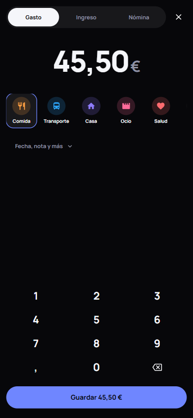
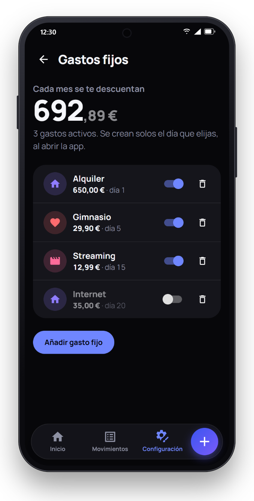

# Holgura

[](https://github.com/Glinbor10/holgura/actions/workflows/ci.yml)
[](https://github.com/Glinbor10/holgura/releases/latest)
[](LICENSE)


[](https://github.com/Glinbor10/holgura/actions/workflows/ci.yml)
[](https://github.com/Glinbor10/holgura/releases/latest)
[](LICENSE)


**Cuánto puedes gastar de verdad.** Holgura es una app para Android que controla tu nómina, tus gastos fijos y variables y cuánto ahorras cada mes. Funciona sin conexión y tus datos no salen de tu móvil.

<p align="center">
  
  
  
  
</p>
<p align="center">
  
  
  
</p>

## Qué hace

- **Te dice cuánto te queda por gastar** este mes y a qué ritmo diario, con una gráfica que puedes recorrer con el dedo para ver cada día.
- **Reparte tu nómina** entre destinos cuando cobras: por ejemplo, 300 € a ahorro y el resto a gastos.
- **Apunta un gasto en segundos**, con un teclado numérico propio y categorías con icono.
- **Crea tus gastos fijos solos** (alquiler, gimnasio, suscripciones) el día que elijas.
- **Cierra el mes contigo.** Si te sobra dinero, decides si pasa a ahorro o se arrastra al mes siguiente. Si te falta, decides si lo cubres con ahorro o lo arrastras.
- **Muestra tu ahorro** mes a mes y el total acumulado.
- **Copia de seguridad** en un fichero que puedes guardar donde quieras (Drive, correo, tu ordenador) y restaurar en otro móvil.
- Modo claro y oscuro según tu móvil.

## Cómo piensa el dinero

Holgura separa dos cosas: dónde está tu dinero y para qué mes es.

- **Los destinos** son como bolsillos con saldo (por ejemplo, *Gastos* y *Ahorro*). Su saldo no se reinicia cada mes.
- **Cada ingreso dice qué mes financia.** Si cobras el día 28, esa nómina financia por defecto el mes siguiente. Así el dinero que cobras en noviembre cuenta para diciembre y no te descuadra el mes en curso.
- **Lo que puedes gastar** es lo que financian tus ingresos ese mes, más lo que arrastras del anterior, menos lo ya gastado.

## Privacidad

- Tus datos se guardan solo en el móvil, en una base de datos local.
- La app no pide ningún permiso de Android y no usa internet.
- No hay cuentas, ni servidores, ni analíticas.

Las copias de seguridad son cosa tuya: las exportas cuando quieres y las guardas donde quieras.

## Instalar en Android

1. Descarga el `.apk` de la [última versión](https://github.com/Glinbor10/holgura/releases/latest) (sección **Assets**) desde tu móvil.
2. Ábrelo e instálalo. Android te pedirá permitir la instalación desde orígenes desconocidos.

Para que las actualizaciones se instalen encima de la versión anterior sin perder datos, el APK tiene que firmarse siempre con la misma clave. Cómo crearla: [`docs/SIGNING.md`](docs/SIGNING.md).

> **Antes de actualizar, exporta una copia de seguridad** desde Ajustes. Si algún día hay que desinstalar la app, esa copia es lo único que recupera tus datos.

## Estado

Versión **0.1, en pruebas**.

- La lógica del dinero (reparto de nómina, cierre de mes, gastos fijos, ahorro) está cubierta por tests automáticos.
- La interfaz está revisada en un navegador a tamaño de móvil, en modo oscuro y en claro.
- Lo que se está probando ahora en un móvil real: el guardado en la base de datos del teléfono, exportar e importar copias, y la instalación del APK firmado.

## Qué viene después

- Importar movimientos desde el CSV del banco.
- Objetivos de ahorro con nombre y meta.
- Una versión web instalable para iPhone.
- Presupuestos por categoría con avisos.

## Desarrollo

Pila: React, TypeScript, Vite, MUI y Capacitor para empaquetar la app Android. La base de datos es SQLite.

```bash
cd app
npm install
npm run dev     # en el navegador (guarda los datos en localStorage)
npm test        # tests de la lógica y de la capa de datos
npm run build
```

Todas las reglas del dinero viven en `app/src/domain` como funciones puras, sin acceso a la base de datos ni a la interfaz, y por eso se pueden probar fácilmente.

| Carpeta | Contenido |
|---|---|
| [`app/`](app/README.md) | Código de la app |
| [`openspec/`](openspec/changes/v0-1-mvp/proposal.md) | Especificación del producto, diseño técnico y tareas |
| [`docs/`](docs/SIGNING.md) | Cómo firmar el APK, capturas de pantalla |
| `.github/workflows/` | CI de las PR y publicación de versiones con su APK |

## Licencia

[PolyForm Noncommercial 1.0.0](LICENSE). Puedes usar, estudiar y modificar Holgura para fines **no comerciales**: uso personal, aficiones, educación y organizaciones sin ánimo de lucro. El uso comercial necesita permiso previo del titular.

Es una licencia de código disponible, no una licencia open-source en el sentido estricto de la OSI, que no permite restringir el uso comercial.

Required Notice: Copyright (c) 2026 Guillermo Linares Borrego

## Publicar una versión

```bash
git tag v0.2.0 && git push origin v0.2.0
```
O desde **Actions > Release > Run workflow**. El workflow compila el APK y crea la release con él adjunto. Si no hay clave de firma configurada, la release sale marcada como pre-release con un APK de debug.
