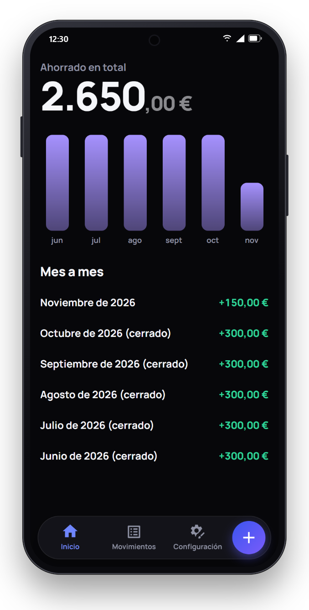
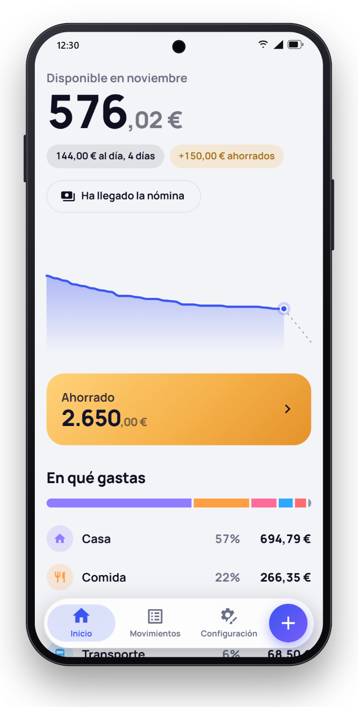

# Holgura

**Cuánto puedes gastar de verdad.**

App Android para controlar tu nómina, tus gastos y tu ahorro. 
Sin conexión, sin cuentas y sin servidores: tus datos no salen de tu móvil.

[**⬇ Descargar la app (APK)**](https://github.com/Glinbor10/holgura/releases/latest)

 

## Qué hace

| | |
|---|---|
| 💶 **Te dice cuánto te queda** | El dinero disponible del mes y el ritmo diario, con una gráfica que recorres con el dedo. |
| 🧾 **Registra tu nómina** | Cuando cobras, un toque. Eliges para qué mes es y se reparte sola entre tus destinos, por ejemplo 300 € a ahorro y el resto a gastos. |
| ⚡ **Apunta un gasto en segundos** | Teclado numérico propio y categorías con icono. |
| 🔁 **Gastos fijos automáticos** | Alquiler, gimnasio o suscripciones se crean solos el día que elijas, y se pueden pausar. |
| ✅ **Cierre de mes** | Si te sobra, decides si pasa a ahorro o se arrastra. Si te falta, decides si lo cubres con ahorro. |
| 🐷 **Ahorro mes a mes** | Histórico y total acumulado. |
| 💾 **Copia de seguridad** | Un fichero que guardas donde quieras y restauras en otro móvil. |
| 🌗 **Claro y oscuro** | Sigue el modo de tu móvil. |

Más capturas

 

  
  
  
  

## Cómo piensa el dinero

Holgura separa dos cosas: **dónde está** tu dinero y **para qué mes es**.

- **Destinos:** son bolsillos con saldo (por ejemplo *Gastos* y *Ahorro*). Su saldo no se reinicia cada mes.
- **Mes que financia:** cada nómina dice qué mes cubre. Si cobras a final de mes, esa nómina financia el mes siguiente: lo que cobras hoy es lo que gastarás en diciembre.
- **Lo que puedes gastar** es lo que financian tus ingresos ese mes, más lo que arrastras del anterior, menos lo ya gastado.

## Privacidad

- Los datos se guardan solo en tu móvil, en una base de datos local.
- La app no pide ningún permiso de Android y no usa internet.
- No hay cuentas, ni servidores, ni analíticas.

Las copias de seguridad son cosa tuya: las exportas cuando quieres y las guardas donde quieras.

## Instalar en Android

1. Desde tu móvil, abre la [última versión](https://github.com/Glinbor10/holgura/releases/latest) y descarga el fichero `.apk` de la sección **Assets**.
2. Ábrelo e instálalo. Android te pedirá permitir la instalación desde orígenes desconocidos.

> [!IMPORTANT]
> **Antes de actualizar, exporta una copia de seguridad** desde Ajustes y guárdala fuera de la app (Drive, correo…). Si alguna vez tienes que desinstalar la app, esa copia es lo que recupera tus datos.

## Estado

Versión **0.1, en pruebas**: puede haber fallos. Si encuentras uno, cuéntalo en las [issues](https://github.com/Glinbor10/holgura/issues/new/choose) sin pegar tus datos reales.

## Qué viene después

- [ ] Importar movimientos desde el CSV del banco
- [ ] Objetivos de ahorro con nombre y meta
- [ ] Versión web instalable para iPhone
- [ ] Presupuestos por categoría con avisos

## Licencia

[PolyForm Noncommercial 1.0.0](LICENSE). Puedes usar, estudiar y modificar Holgura para fines **no comerciales**: uso personal, aficiones, educación y organizaciones sin ánimo de lucro. El uso comercial necesita permiso previo del titular.

Es una licencia de código disponible, no una licencia open-source en el sentido estricto de la OSI, que no permite restringir el uso comercial.

Required Notice: Copyright (c) 2026 Guillermo Linares Borrego

Código y guía de desarrollo: [`docs/DESARROLLO.md`](docs/DESARROLLO.md)
